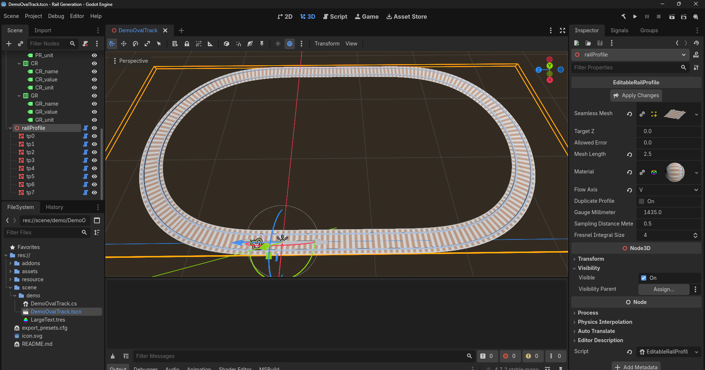
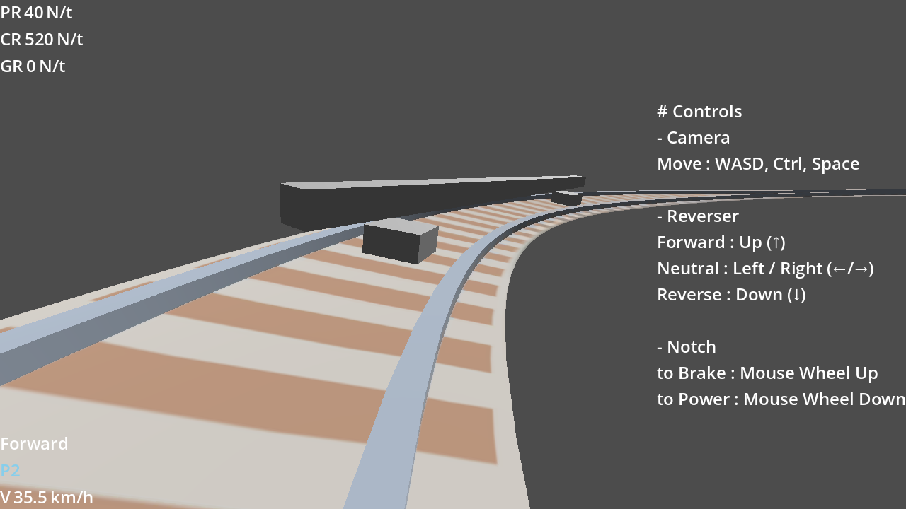
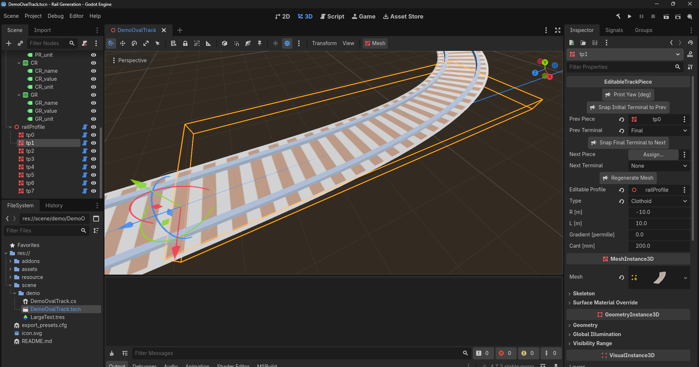

<div align="center">

<h1 align="center">Rail Generation</h1>
</div>

A Godot addon for procedural generation of railway

This addon features :
- extracting edges from a seamless mesh (*.obj) with constraints Z = k
- mesh extrusion using extracted edges and unit speed curve
- simple railway vehicle dynamics
- WYSIWYG track designing on Godot editor

This addon defines 4 types of unit speed curves :
- line
- vertical curve (arc)
- horizontal curve (helix)
- Clothoid (a.k.a. Euler spiral)
## 🛠️How to Build
(1) Clone this repository.
```bash
git clone https://github.com/joung2321/Rail-Generation.git
```
(2) Open **project.godot**  
(3) Build Project  
(4) Open and run a main scene, **DemoOvalTrack.tscn**
<p>


</p>

## 🎢Track Design Guide
To be added.  
Please refer to **DemoOvalTrack.tscn** for now.
<p>

</p>

## 📄License
This project is released under the MIT License.